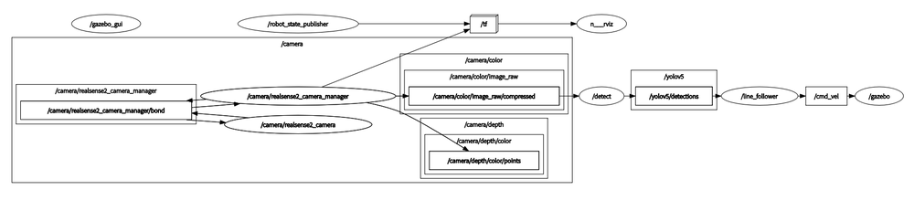
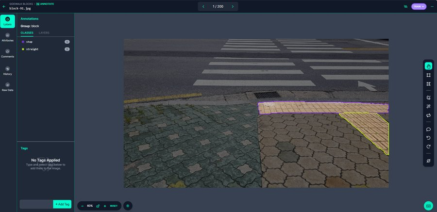
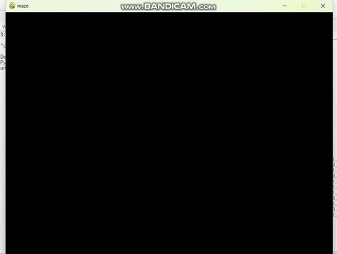
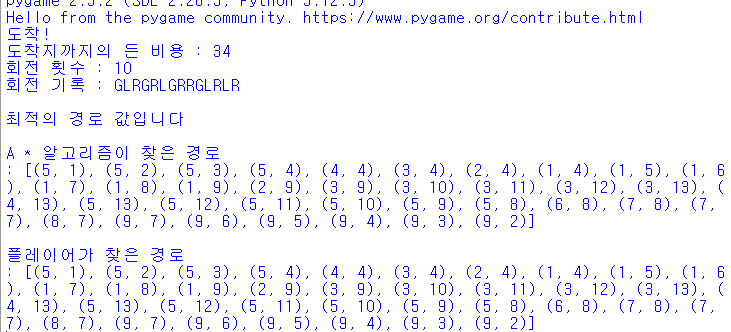
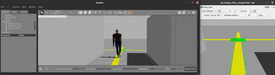
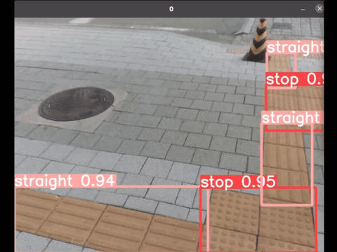
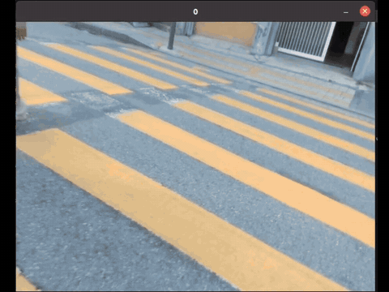

# Assistive Navigation System for Visually Impaired Pedestrians

> Team project (3 students), Capstone Design 1, School of Mechanical Engineering, Chung-Ang University, Spring 2024.

> Navigation software that helps a visually impaired pedestrian follow tactile paving: **YOLOv5** detects the paving blocks, an **A\*** navigator turns the route into Left / Right / Go commands, and a **discrete PID** controller keeps the walker on the line. Built and tested in **ROS1 + Gazebo**, then checked outdoors with an **Intel RealSense D435** camera.

## Project Highlights

| Gazebo Simulation (walking actor) | Route Following in Gazebo (`RLLR`) | YOLOv5 Tactile Paving Detection |
|:-----------------------:|:--------------------------------------:|:-------------------------------------:|
|  |  |  |

## Project Overview

Tactile paving guides visually impaired pedestrians, but they can only check it with a cane, one step at a time. The goal was the software part of a future wearable guide:

1. **See** the tactile paving (vision),
2. **Decide** which way to turn at each junction (path decision),
3. **Follow** the paving smoothly (control).

Because of time and hardware limits, the work focused on software: the full loop was developed in simulation (software-in-the-loop), and the detector was then tested with a real RGB-D camera on the street (hardware-in-the-loop).

## System Architecture

The "Capstone Design Map" from the final presentation:

```text
D435 camera / Gazebo belt camera
        │
        ▼
Detector    YOLOv5: classes "straight" / "stop" (tactile paving), line error
        │
Navigator   A* (Manhattan heuristic) on a grid map → command string of G / L / R
        │
Follower    tracks "straight" blocks; at a "stop" block, turns as the Navigator says
        │
Controller  discrete PID (30 Hz) → angular velocity
        │
Motioner    publishes /cmd_vel to the Gazebo actor (or, later, a signal to the user)
```

<p align="center"><br><em>ROS rqt graph of the system (RealSense → YOLOv5 → line follower → /cmd_vel)</em></p>

## Methodology

### 1. Detector: tactile paving detection (YOLOv5)

- Dataset: 365 photos labeled in Roboflow, two classes: `straight` (guide blocks) and `stop` (warning blocks). Split 7:1:2 (train / validation / test).
- Model: YOLOv5s trained for 150 epochs (batch 16); YOLOv5m was also used.
- Connected to ROS Noetic through `realsense-ros` and `yolov5_ros`, using an Intel RealSense D435.

<p align="center"><br><em>Labeling in Roboflow</em></p>

### 2. Navigator: route decision (A\*)

- A\* search on a grid map with the Manhattan distance as the heuristic (it fits the grid shape of sidewalks).
- The found path is simplified into turn commands at each junction: `G` (go), `L` (left), `R` (right).
- Prototype in Pygame: path cost 34, 10 turns, command string `GLRGRLGRRGLRLR`.

| A\* on the grid map | Output: path and command string |
|:---:|:---:|
|  |  |

### 3. Simulation: Gazebo actor with a belt camera

- Based on the TurtleBot3 line follower and the Gazebo ROS Actor Plugin; a walking human actor with a camera on its belt follows yellow tactile paving.
- The actor is driven through `/cmd_vel`.

<p align="center"><br><em>Turning at a junction in Gazebo (left: world, right: belt camera view)</em></p>

### 4. Controller: discrete PID

- PID designed in discrete time (sampling at 30 Hz, T = 1/30 s).
- Gains tuned by trial and error, then checked with the Ziegler–Nichols formulas.
- Step-response analysis from the final presentation (best case of each type):

| | P (Kp = 0.01) | PD (Kp = 0.01, Kd = 0.5) | PID (Kp = 0.01, Kd = 0.1, Ki = 4e-8) |
|---|:---:|:---:|:---:|
| Steady-state error | 0.00 | 0.00 | 0.00 |
| Overshoot | 16.42 % | **12.41 %** | 15.33 % |
| Rising time | 0.417 s | 0.457 s | 0.428 s |
| Settling time | 4.47 s | 4.58 s | 4.54 s |
| RMSE | 33.43 | 35.49 | 32.99 |

PD control was chosen: it has the lowest overshoot, and a person cannot react instantly, so an integral term could build up a large command.

### 5. Follower: route following

- Follows `straight` blocks with the controller. When a `stop` block appears, it walks on until the block leaves the view, then turns as the Navigator says.
- It keeps turning until the next `straight` block is found, and checks that the error is going down in the turning direction.

## Results

- **Simulation:** after a common path (`RLLR`), the actor reached all three goals (Top `LLR`, Mid `LRGR`, Bot `RRLR`) in Gazebo.
- **Real camera:** with the D435, the model told `stop` and `straight` blocks apart with about 90 % confidence, even with many blocks in one frame.
- **Look-alike test:** a yellow crosswalk has a similar color, but it was not detected as tactile paving; only the paving pattern was.

| Tactile paving on the street | Yellow crosswalk (not detected) |
|:---:|:---:|
|  |  |

## Software Stack

| Category | Technologies |
|----------|--------------|
| OS / Middleware | Ubuntu 20.04, ROS Noetic (topics, launch, rosbag) |
| Simulation | Gazebo Classic 11, Gazebo ROS Actor Plugin, TurtleBot3 |
| Programming | Python 3 (C++ for the Gazebo actor plugin) |
| Perception | YOLOv5s / YOLOv5m, Roboflow, OpenCV |
| Planning | A\* (Pygame prototype) |
| Control | Discrete PID |
| Analysis | pandas, matplotlib |
| Sensor | Intel RealSense D435 (RGB-D) |
| Visualization | RViz, rqt |

## Key Contributions

- Developed an integrated navigation framework (Detector → Navigator → Follower → Controller → Motioner).
- Connected an Intel RealSense D435 camera to YOLOv5 in ROS.
- Developed tactile paving detection using YOLOv5.
- Implemented global path planning with A\*.
- Designed a discrete PID controller for trajectory tracking.

## Repository Structure

```text
.
├── bashes/                      # setup and run scripts (ROS Noetic install, build, launch)
├── worlds/                      # Gazebo worlds and tactile paving models (maze, path)
└── src/
    ├── actor_line_follower/     # main package: Gazebo actor + follower, detector, controller, planner
    ├── turtlebot3_line_follower/# TurtleBot3 line follower used as the starting point
    ├── yolov5_ros/              # YOLOv5 ROS node and trained weights (best.pt)
    ├── detection_msgs/          # bounding-box messages for YOLOv5
    ├── realsense-ros/           # Intel RealSense ROS driver
    ├── ddynamic_reconfigure/    # dependency of realsense-ros
    ├── gazebo-ros-actor-plugin/ # Gazebo actor velocity plugin
    └── turtlebot3_simulations/  # TurtleBot3 Gazebo packages
```

The A\* Pygame prototype is not in this repository.

## Limitations and Future Work

- Works only where tactile paving exists. Next step: recognize people, vehicles, buildings and traffic lights to guide on paths without paving.
- Detection can fail or lag with many obstacles, busy streets, or changes in light and weather; more varied training data is needed.
- Feedback to the user (bone-conduction audio, vibration glove, or short sound messages) was proposed but not built.
